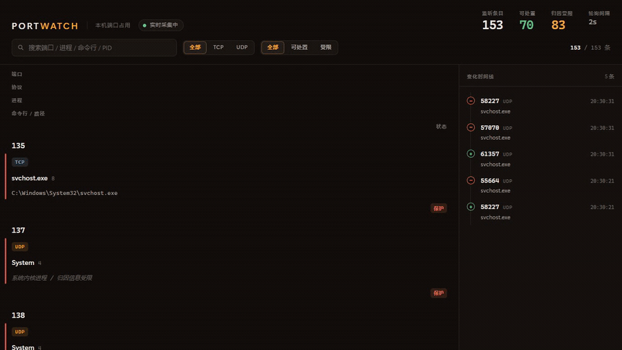
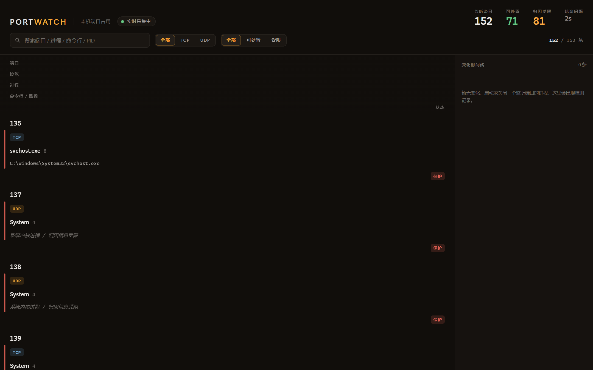
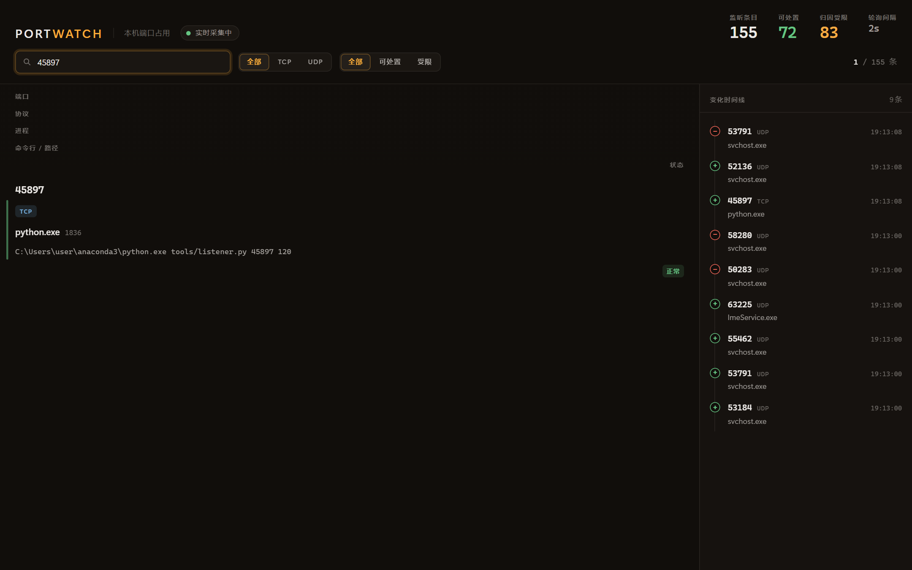

# portwatch


把「本机哪个端口被哪个进程占了」从 `netstat` 的一行 `IP:PORT`，变成一条**可追溯的归因链路**，并把每次占用的出现 / 消失留档成**可回溯的历史**。



> 真实运行录屏（900px / 8 fps / 约 24 秒，未加速）：起一个监听端口 → 列表新增该行并高亮、右侧时间线出现 `added` → 释放后该行消失、时间线出现 `removed`。

Windows 上排查端口占用，常规路径是 `netstat -ano` 拿到 PID，再去任务管理器 / `tasklist` 反查进程名。这条路断在两个地方：

- **链路断** —— 只能看到 PID，看不到这个进程的完整命令行、可执行文件路径、工作目录、启动时间。而「到底是我 3 天前起的那个测试服务，还是某个后台常驻进程」往往只能靠 `cmdline` / `cwd` 才能判断。
- **时间断** —— `netstat` 只有「此刻」。端口什么时候被占上的、什么时候悄悄消失的、某进程是否规律性反复占用同一端口，全都没有记录，只能靠人守在那儿看。

portwatch 补上这两段：**归因链路** + **2 秒粒度的实时增量** + **只追加的历史留档**。

## 功能

| 能力 | 说明 |
|---|---|
| 归因链路 | 端口 → 协议 → PID → 进程名 → exe 路径 → 启动命令行 → 工作目录 → 进程启动时间，并给出**归因完整度**（`full` / `partial` / `denied` / `gone`）——权限不足时如实降级，不抛异常 |
| 实时仪表盘 | 单页应用，2 秒一轮 SSE 增量推送；新增条目有进入动画、属性变化有闪烁，右侧「变化时间线」记录 `added` / `removed` / `changed` |
| 历史留档 | append-only 事件表（真相源）+ 由事件物化出的占用区间表；区间闭合区分「真实观测到消失」与「对账推断闭合」 |
| 可处置性判定 | 明确区分「能处置」与「系统保留」，对内核进程 / 归因受限条目打保护标记，避免误杀系统服务 |
| 安全边界 | 只监听 `127.0.0.1`，CORS 只放行 localhost——该服务具备处置本机进程的能力，刻意不暴露到局域网 |



搜索一个端口，就能一次看清它的完整链路；右侧时间线里同时能看到它被观测到的 `added` 事件：



> 截图取自本机真实运行（截图中的本机用户名已脱敏）。样例中的监听进程来自 `tools/listener.py`。

## 快速开始

**依赖**：Python 3.10+（开发环境为 3.11）、Node 20+（仅前端需要）。

```bash
# 后端依赖
pip install -r requirements.txt

# 终端 1：API 层（同时自动装配历史层）
python server.py                 # → http://127.0.0.1:8787

# 终端 2：前端
cd web
npm install
npm run dev                      # → http://127.0.0.1:5173
```

前端默认连 `http://127.0.0.1:8787`，可用 `web/.env.local` 里的 `VITE_API_BASE` 覆盖。`npm run build` 产物在 `web/dist`。

**只跑采集层**（排查归因问题的第一手段，不经服务、不落库）：

```bash
python collector.py                  # 采集一次，打印摘要表
python collector.py --json ports.json # 同时写出 JSON 快照（schema: portwatch/v1）
python collector.py --raw             # 关闭 IPv4/IPv6 双栈合并
python collector.py --tcp-only        # 只采 TCP 监听，不含 UDP
```

**冒烟自检**：

```bash
curl http://127.0.0.1:8787/api/health   # status=ok、cycles 持续增长、history.errors=0
curl http://127.0.0.1:8787/api/meta     # schema / interval / is_admin / stats
curl -N http://127.0.0.1:8787/api/stream # SSE：首帧 snapshot，之后 delta
```

**端到端验证采集链路**（比单测可信得多）：

```bash
# 1) 起一个真实监听进程占端口（脚本在 tools/）
python tools/listener.py 8899
# 2) 等几个采样周期后看页面：出现进入动画与时间线 added
# 3) 停掉监听：看到时间线 removed
# 4) 排障：打印库内事件与区间摘要
python history.py --dump
```

## 测试

```bash
pip install -r requirements-dev.txt
python -m pytest tests -q
```

16 个用例，分三类契约（都不依赖管理员权限）：

| 文件 | 钉住的东西 |
|---|---|
| `tests/test_collector.py` | 快照 schema（`portwatch/v1`）与统计口径自洽、字段取值域；**自己起的监听端口必须被归因到自己**（端口 → PID → 进程的链路真的通） |
| `tests/test_server.py` | 身份键格式、可处置性的保守判定、diff 语义（只有 `WATCH_FIELDS` 变化才算 `changed`；`removed` 只回身份信息） |
| `tests/test_history.py` | 三条设计纪律：`last_seen_at` 必须被心跳推进、`port_event` 只由真实观测追加（心跳与对账都不许写事件表）、心跳与对账不会凭空造区间 |

> 采集层测试在权限受限的环境下会**如实 skip**（拿不到全局连接表时跳过，而不是假装通过）。
> 端到端验证（起一个真实监听端口，看事件、区间与对账）见 `tools/listener.py` 与 `HANDOVER.md` 附录 C —— 那条链路比单测更接近真实场景。

## 架构

四层，职责边界清晰（改代码前先确认改动落在哪一层）：

```
collector.py   采集层：psutil 拉本机监听端口，沿 PID 归因到进程全字段；不关心 diff / 历史 / 落库
server.py      API 层：单例 Scanner 每 2s diff 快照 → SSE 广播 + 交给历史层；不直接写库
history.py     历史层：SQLite 事件表 + 区间表、批量落库、心跳、对账；不参与对外接口契约
web/           前端  ：只消费 SSE 与 REST，不做业务推断
```

```
psutil.net_connections(kind="inet")
  → TCP 只留 CONN_LISTEN / UDP 全收 → 按 (proto, port, pid) 分桶（双栈合并）
  → 进程信息按 PID 缓存，逐字段降级
        │
        ▼  Scanner 每 2.0s tick：curr = {entry_key: entry}，entry_key = "proto:port:pid"
   delta = compute_delta(prev, curr)   → added / removed / changed
     ├─ 有内容 → SSE 广播 delta
     ├─ 有内容 → event_sink(delta)      → 历史层 enqueue（同步非阻塞，绝不 await）
     └─ 每轮   → heartbeat_sink(latest) → 刷新活跃区间 last_seen_at（无 delta 也刷）
        │
        ▼
   前端 usePortStream：snapshot 灌全量 → delta 局部增删改 + 推时间线 → heartbeat 标记存活
```

**HTTP 接口**（均为 GET、无鉴权、仅本机可访问）：

| 路径 | 参数 | 返回要点 |
|---|---|---|
| `/api/health` | — | `status`(`ok`/`warming_up`)、`cycles`、`subscribers`、`last_error`、`history`（落库统计） |
| `/api/meta` | — | `schema`、`interval`、`host`、`platform`、`is_admin`、`collected_at`、`stats` |
| `/api/ports` | `proto` / `q` / `access` / `limit` | 已做可处置性标注的条目列表（首轮未完成时 `warming_up: true`） |
| `/api/stream` | — | SSE：首帧 `snapshot`，之后 `delta`；15s 空闲发传输层 `heartbeat` |

## 数据模型

两张表，两种角色——**事件表是唯一信任锚，区间表是可计算的物化视图**：

```sql
CREATE TABLE port_event (            -- append-only 事件真相源
  id INTEGER PRIMARY KEY AUTOINCREMENT,
  entry_key TEXT NOT NULL,           -- proto:port:pid
  inv_key TEXT,                      -- proto:port:pid:create_time（进程实例键）
  occurred_at TEXT NOT NULL,         -- 观测时刻
  event_type TEXT NOT NULL CHECK (event_type IN ('added','removed','changed')),
  proto TEXT, port INTEGER, pid INTEGER,
  process_name TEXT, exe TEXT, cmdline TEXT, cwd TEXT,
  create_time TEXT, local_addrs TEXT, detail TEXT
);

CREATE TABLE port_occupancy (        -- 区间物化表：一次占用 first_seen_at → ended_at
  inv_key TEXT PRIMARY KEY,
  proto TEXT NOT NULL, port INTEGER NOT NULL, pid INTEGER NOT NULL,
  process_name TEXT, exe TEXT, cmdline TEXT, cwd TEXT, create_time TEXT, local_addrs TEXT,
  first_seen_at TEXT NOT NULL, last_seen_at TEXT NOT NULL,
  ended_at TEXT,                     -- NULL = 仍在占用
  end_reason TEXT                    -- observed_removed | reconciled
);
```

- `inv_key = proto:port:pid:create_time`：比条目身份键多带进程创建时间，用于在存储侧区分「同一个 PID 被复用」的前后两个进程实例。
- `end_reason` 只有两个值：`observed_removed`（采集层真实观测到条目消失）与 `reconciled`（对账时发现快照中已不存在，属推断闭合）。
- SQLite 走 WAL + `synchronous=NORMAL`，所有 sqlite3 调用都在 `asyncio.to_thread` 里执行。

## 时间语义（诚实声明）

采样是**离散**的（默认 2 秒一轮），一次 diff 只能把变化定位在 `(上一轮采样时刻, 本轮采样时刻]` 这个半开区间内。因此 `occurred_at` / `first_seen_at` / `last_seen_at` 记录的是**观测到该变化的采样时刻**，不是事件真实发生的时刻：

- 存在最多一个采样间隔（默认 2 秒）的不确定性；
- 若两个变化落在同一采样区间内先后发生，**它们的先后顺序会丢失**；
- 对仍未闭合的区间，`last_seen_at` 的含义是「截至最后一轮采样，该占用仍在监听」的最近观测时刻。

字段名刻意用 `first_seen_at` / `occurred_at` 而非 `start_time` / `event_time`，就是为了不误导使用者。**任何基于这张表算「占用时长」的代码，都必须把 2 秒的采样不确定性带到结论里。**

## 几个工程取舍

- **Windows 上 `psutil.Process.ppid()` 是性能陷阱**：每次调用都会重建一次全量进程快照（约 45ms），逐进程取父进程时整轮采集从毫秒级恶化到 **4476ms**，2 秒轮询周期被吃穿。改用一次快照 + 查表后降到 **73ms**（代码里保留 `process_iter` 兜底分支，因为用到了 `psutil._pswindows` 私有 API，跨版本需回归）。
- **分层纪律**：`port_event` 只能由采集层的真实观测（`added` / `removed` / `changed`）追加；心跳刷新、对账闭合这类「推断」只允许改区间表。一旦让推断写进事件表，就再也分不清「观测到的」和「猜出来的」。
- **历史层绝不允许影响实时链路**：投递侧是同步非阻塞 `put_nowait`、绝不 await、绝不抛异常；消费侧每条 delta 独立事务、DB 异常只记日志；装配侧历史层初始化失败也照常启动服务；停机时先停采集再 flush 队列。
- **为什么是「2 秒轮询 + diff」而不是监听事件**：ETW / WMI 事件订阅 / 内核回调的复杂度、权限要求与跨平台成本都高，且难以保证不漏不重。轮询 + diff 简单可移植（优化后整轮约 73ms），代价是引入采样不确定性——用上面的方式如实声明，而不是假装精确。
- **内核进程取不到 `cmdline` / `cwd` 是安全边界，不是 bug**：`System`(PID 4)、`svchost`、`lsass` 等即便以管理员运行也可能被拒绝，提权也拿不到。设计回应是逐字段降级 + 保守保护（`pid ∈ {0,4}` 或归因受限即视为不可处置），而不是硬编码进程白名单。

## 已知限制

1. **不回溯服务启动前的占用**：区间只能由「观测到的 `added`」开出，因此服务首次启动时就在监听的进程（系统服务、浏览器、常驻 UDP）没有区间行；它们之后退出时事件表会留下 `removed`，但没有区间可闭合。所以 `/api/health` 里 `open_intervals ≤ active_intervals` 是正常现象。
2. **PID 复用会漏检**：条目身份键仍是 `proto:port:pid`，若某 PID 被复用且新进程恰好占同一端口，两轮 diff 得到同一个 key，产不出 `removed` + `added`（存储侧的 `inv_key` 已能区分实例，但源头没产 delta）。修复需要前后端同步改身份键，属已知待办。
3. **事件表无保留期**：`port_event` 只追加不删除，长期运行会线性增长（已有索引缓解查询，但需引入归档/分区策略）。
4. **非管理员运行时归因受限条目明显偏多**：以管理员身份启动可拿到大部分进程的 `cmdline` / `cwd`，`/api/meta` 的 `is_admin` 会如实回报。
5. **SSE 的 `error` 事件前端尚未监听**：采集异常目前只能通过 `/api/health` 的 `last_error` 发现。
6. **平台**：主要在 Windows 上开发与验证；Linux / macOS 可用（`psutil` 跨平台），但未做系统验证，且 `ppid_map` 的性能优化是 Windows 专属。

## 项目结构

```
portwatch/
├─ collector.py            采集层：端口 → 进程归因（psutil）
├─ server.py               API 层：FastAPI + 单例 Scanner + SSE 广播 + 历史层装配
├─ history.py              历史层：SQLite 事件表 / 区间表、批量落库、心跳、对账（含 --dump CLI）
├─ tools/listener.py       验证用小工具：起一个真实监听进程，复现「新增 → 消失」全链路
├─ HANDOVER.md             交接文档：接手操作、隐性知识、缺陷清单与后续路线（深度阅读）
├─ requirements.txt        后端依赖
└─ web/                    前端（React 19 + Vite + TypeScript）
   └─ src/
      ├─ hooks/usePortStream.ts   SSE + useReducer 状态机（snapshot 灌全量、delta 局部更新）
      ├─ components/              Header / FilterBar / PortList / Timeline / EmptyState
      ├─ api.ts                   API_BASE、normalizeDelta 容错归一
      ├─ filters.ts               rowStateOf（ok / limited / protected）、过滤与排序
      └─ styles/                  设计令牌（OKLCH 色彩 / 间距 / 动效）与组件样式
```

界面设计取向：工业仪器面板——暖调深灰 + 琥珀强调色，端口号等宽 + `tabular-nums` 对齐，动效只用 `transform` / `opacity` 且遵循 `prefers-reduced-motion`。

## 文档

- **[HANDOVER.md](HANDOVER.md)** —— 交接文档，也是本项目的「隐性知识」合集：目录职责、接口契约、表结构、时间语义、**关键工程决策与踩坑**（性能陷阱、分层纪律、故障隔离）、按优先级排序的缺陷清单与后续路线、端到端验证方法。想深入读代码前建议先读它。
- `web/README.md` —— 前端说明与设计取向。

## Roadmap

- [ ] 区间查询 API + 前端可视化（`GET /api/history/intervals?port=&from=&to=&open_only=`，配合甘特 / 热力图）
- [ ] 启动首轮 bootstrap 记 `added`，解决「不回溯启动前占用」的口径问题
- [ ] 条目身份键升级为 `proto:port:pid:create_time`（含前后端同步回归）
- [ ] `port_event` 保留期与归档（或迁 PostgreSQL 分区表）
- [ ] 处置动作（结束进程）与权限确认流程

## License

[MIT](LICENSE)

---

开发方式说明：本项目的架构设计、工程取舍与验证标准由作者把控，编码过程使用了 AI 辅助（对话式协作）。README 与 HANDOVER 中所有性能数字、缺陷现象均为实机实测所得。
